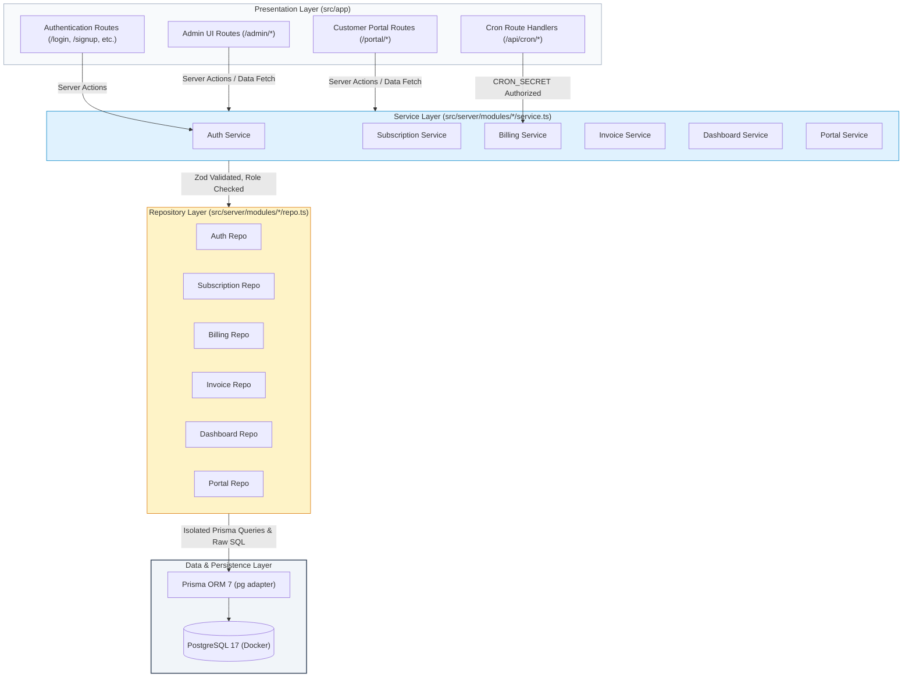
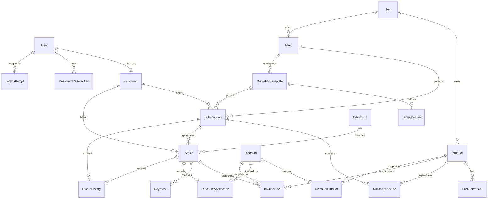
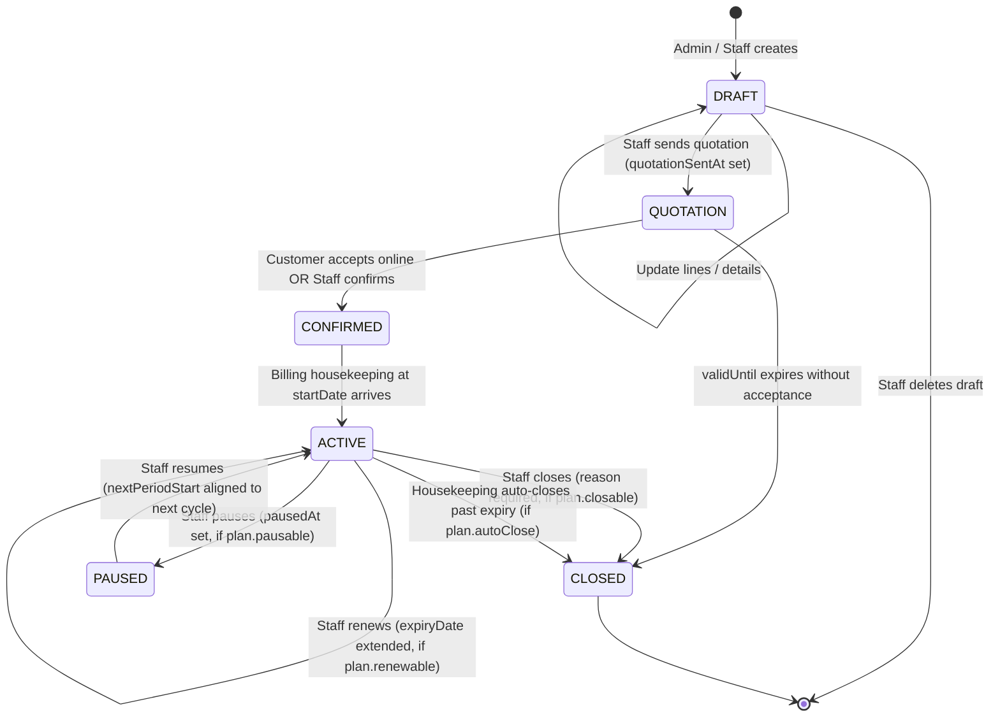
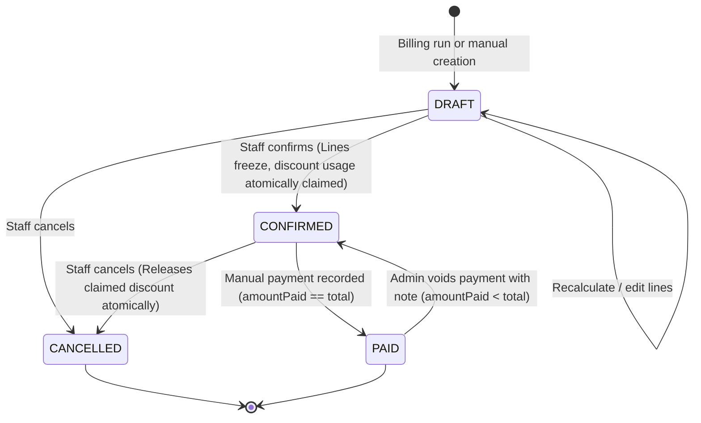

# BrightLoop: B2B Subscription Billing and Invoicing Engine

BrightLoop is an enterprise-grade recurring billing, subscription lifecycle management, and invoicing platform built for Indian B2B operations. Traditional recurring billing systems either rely heavily on third-party SaaS platforms with strict vendor lock-in or suffer from floating-point arithmetic errors, billing drift across irregular month boundaries, race conditions during batch execution, and inconsistent financial audit trails. BrightLoop solves these challenges through a deterministic architecture featuring integer-paise financial mathematics, immutable snapshotting of confirmed invoice and subscription lines, strictly sequential database number sequences, atomic discount allocation, an idempotent catch-up billing engine executed under PostgreSQL transaction-level concurrency locks (`SKIP LOCKED`), and comprehensive role-based access control with customer data isolation.

### Stack and Dependency Versions

Dependencies and exact versions extracted directly from [`package.json`](file:///c:/Users/HP/Desktop/BrightLoop/package.json):

- **Application Framework**: Next.js 16.4.3 (App Router, Server Actions, Route Handlers)
- **UI & Runtime**: React 19.3.0, React DOM 19.3.0
- **Database & ORM**: PostgreSQL 17.11 (via Docker), Prisma ORM 7.10.0, `@prisma/client` 7.10.0, `@prisma/adapter-pg` 7.10.0, `pg` 8.23.1
- **Validation**: Zod 4.6.7
- **Styling & Components**: Tailwind CSS 4.x, shadcn 4.23.0, Radix UI Slot 1.5.0, Lucide React 1.64.0, Sonner 2.0.8
- **Authentication & Security**: Jose 6.2.14 (stateless JWT), Bcryptjs 3.0.3 (cost factor 12)
- **Language & Development**: TypeScript 5.x, Vitest 5.0.5, ESLint 9.x, tsx 4.23.15, `@faker-js/faker` 10.6.0
- **Package Manager**: pnpm 12.16.1

---

## Build Environment

The performance metrics and test suites documented in this specification were physically measured on the host workstation detailed below.

| Component | Specification / Version |
| :--- | :--- |
| **Operating System** | Microsoft Windows 11 Pro (Build 10.0.26300, 64-bit) |
| **Processor (CPU)** | Intel(R) Core(TM) i5-8350U CPU @ 1.70GHz (4 Cores, 8 Logical Processors) |
| **System Memory (RAM)** | 15.85 GB Physical Memory |
| **Node.js** | v24.13.0 |
| **pnpm** | 12.16.1 |
| **Docker Engine** | Docker version 29.9.2, build a82e528 |
| **PostgreSQL Container** | PostgreSQL 17.11 (`postgres:17-alpine`) |

*Note: All performance benchmark numbers reported in this document were measured directly on this machine against a database populated with 5,017 subscriptions and 31,002 invoices.*

---

## Requirements Traceability

The table below maps each requirement area from the domain specification to its implementing module, user-facing routes, test suite, and verified implementation status.

| Requirement Area | Implementing Server Module | Routes / Pages | Automated Test Suite | Status |
| :--- | :--- | :--- | :--- | :---: |
| **Accounts & Auth** | `src/server/modules/auth` | `/signup`, `/login`, `/forgot-password`, `/reset-password`, `/api/auth/logout` | `tests/integration/auth.test.ts`, `tests/unit/auth-utils.test.ts` | **Done** |
| **Roles & RBAC** | `src/server/modules/staff`, `src/server/modules/customers` | `/admin/staff`, `/admin/customers`, `/admin/customers/[id]` | `tests/integration/specs-02-03-04.test.ts` | **Done** |
| **Products & Variants** | `src/server/modules/products` | `/admin/products`, `/admin/products/[id]` | `tests/integration/specs-02-03-04.test.ts` | **Done** |
| **Plans & Availability** | `src/server/modules/plans` | `/admin/plans` | `tests/integration/specs-02-03-04.test.ts` | **Done** |
| **Quotation Templates** | `src/server/modules/templates` | `/admin/templates` | `tests/integration/specs-05-06.test.ts` | **Done** |
| **Subscription Lifecycle** | `src/server/modules/subscriptions` | `/admin/subscriptions`, `/admin/subscriptions/[id]` | `tests/integration/specs-05-06.test.ts` | **Done** |
| **Discounts & Evaluation** | `src/server/modules/discounts` | `/admin/discounts` | `tests/unit/discounts-evaluator.test.ts`, `tests/integration/specs-05-06.test.ts` | **Done** |
| **Billing Engine & Cron** | `src/server/modules/billing` | `/admin/billing`, `/api/cron/billing` | `tests/unit/billing-periods.test.ts`, `tests/unit/billing-compute.test.ts`, `tests/integration/billing-engine.test.ts` | **Done** |
| **Invoicing & Statements** | `src/server/modules/invoices` | `/admin/invoices`, `/admin/invoices/[id]`, `/admin/invoices/[id]/print` | `tests/integration/invoices.test.ts` | **Done** |
| **Taxes & GST Math** | `src/server/modules/taxes`, `src/lib/money.ts` | `/admin/taxes` | `src/lib/money.test.ts`, `tests/integration/specs-02-03-04.test.ts` | **Done** |
| **Manual Payments & Voids** | `src/server/modules/payments`, `src/server/modules/invoices` | `/admin/invoices/[id]`, `/portal/payments` | `tests/integration/invoices.test.ts` | **Done** |
| **Online Payments (Razorpay)** | `src/server/modules/payments` | `/portal/invoices/[id]` (Disabled CTA) | — | **Not built** |
| **Customer Portal & IDOR** | `src/server/modules/portal` | `/portal`, `/portal/subscriptions`, `/portal/invoices`, `/portal/payments` | `tests/integration/portal-idor.test.ts` | **Done** |
| **Reporting & Dashboard** | `src/server/modules/dashboard` | `/admin` (KPIs, SVG Chart, Breakdown) | `tests/unit/mrr-normalization.test.ts` | **Done** |
| **High-Scale Performance** | Repository layer raw SQL aggregations & indexes | `/admin`, `/admin/invoices` | `scripts/perf.ts`, `docs/perf-results.md` | **Done** |

---

## Architecture

BrightLoop adheres to a strict four-layer architecture enforcing complete separation of presentation, business logic, persistence, and storage.



### Architectural Principles and Invariants

1. **Thin Routes & Views**: Files in `src/app` contain only UI layout, component wiring, client-side interactions, and Next.js Server Action entry points. They never import Prisma, never contain raw SQL, and never execute business calculations.
2. **Server-Only Enforcement**: Every server module and repository file begins with `import "server-only"`. Any inadvertent import of server logic into client components triggers an immediate compile-time failure.
3. **Prisma Isolation**: Only repository files (`src/server/modules/<name>/repo.ts`) and `prisma/seed.ts` import the Prisma client instance. Neither services nor routes touch Prisma directly.
4. **Mandatory Service-Layer Authorization**: Every exported service function takes the session context (`Session | null`) as its initial argument and executes `requireRole(session, ...roles)` prior to performing any operation. Customer-facing queries enforce strict ownership filtering scoped by `session.user.customerId`.
5. **Strict Server-Side Validation**: All inputs across mutations and service boundaries are parsed through Zod schemas before being processed.

---

## Data Model

The relational schema models identity, product cataloging, subscription state machines, snapshot-backed invoicing, and transactional ledger accounting.



### Key Integrity Constraints and Indexes

- **Idempotency Constraint**: `Invoice(subscriptionId, periodStart)` has a strict compound `UNIQUE` constraint, preventing duplicate invoice generation for identical billing cycles.
- **Variant Uniqueness**: `ProductVariant(productId, attribute, value)` enforces unique attribute sets per product.
- **Sequential Defaults**: PostgreSQL sequences `subscription_number_seq` and `invoice_number_seq` populate `SUB-000000` and `INV-000000` identifiers natively via database defaults.
- **Compound Query Indexes**: `Invoice(status, dueDate)` powers overdue derived queries; `Invoice(customerId, status)` accelerates customer portal queries; `Subscription(status, nextPeriodStart)` optimizes candidate selection during billing runs.
- **Audit Logging**: `StatusHistory(entity, entityId)` tracks state transitions with timestamps and user references.

---

## State Machines

### Subscription Lifecycle State Machine



### Invoice Lifecycle State Machine



*Note on Overdue State: "Overdue" is not a stored database status. It is a dynamically derived property evaluated at query time when `status == CONFIRMED && dueDate < today && amountPaid < total`.*

---

## Engineering Decisions That Matter

1. **Idempotent Billing via `UNIQUE(subscriptionId, periodStart)` and `FOR UPDATE SKIP LOCKED`**  
   Recurring billing runs select candidate subscriptions using `FOR UPDATE SKIP LOCKED` inside dedicated per-subscription database transactions, allowing safe concurrent multi-worker execution without lock contention. Invoices enforce a compound `UNIQUE(subscriptionId, periodStart)` constraint; any concurrent collision triggers error code `P2002`, gracefully incrementing the `skipped` counter without failing the run.

2. **Catch-Up and Pause Semantics**  
   When a subscription experiences multiple missed billing cycles, the engine iterates chronologically from `nextPeriodStart` up to `asOfDate`, generating separate invoices in advance for each elapsed cycle. When a subscription is paused, its billing periods are skipped entirely, and upon resumption `nextPeriodStart` is mathematically realigned to the first valid cycle boundary on or after the resume date.

3. **Integer Paise Mathematics and Basis Points Rounding**  
   To eliminate floating-point representation errors, all monetary amounts are stored as integer paise (1 INR = 100 paise), and tax rates are stored in integer basis points (1800 bps = 18.00%). Tax computation uses half-up rounding (`Math.round((amount * rateBps) / 10000)`) on a per-line basis, guaranteeing that line items exactly sum to invoice subtotals and tax totals.

4. **Line Item Snapshots and Post-Confirmation Immutability**  
   Subscription lines and invoice lines create independent, frozen data snapshots capturing product names, descriptions, unit prices, variant adjustments, and tax rates at their creation time. Once an invoice transitions from `DRAFT` to `CONFIRMED`, line items become completely immutable, preventing catalog price updates or tax alterations from retroactively changing historical financial records.

5. **Derived Overdue Status**  
   Rather than running scheduled batch jobs to update an "OVERDUE" status column, overdue state is dynamically derived at query time based on `status = 'CONFIRMED' AND dueDate < CURRENT_DATE AND amountPaid < total`. This eliminates state synchronization lag, prevents status mutation races during payment recording, and simplifies reporting queries.

6. **Best-Single-Discount Selection and Atomic Usage Accounting**  
   The discount engine evaluates candidate discounts as a pure in-memory calculation selecting the single discount that maximizes customer savings across eligible products or subscription lines. Discount usage is claimed atomically upon invoice confirmation using conditional SQL (`UPDATE "Discount" SET "usedCount" = "usedCount" + 1 WHERE id = ... AND "usedCount" < "usageLimit"`); if exhausted, confirmation aborts with `RECONFIRM_REQUIRED`, stripping the discount and recalculating draft totals.

7. **Database Sequences for Document Numbering**  
   Subscription numbers (`SUB-XXXXXX`) and invoice numbers (`INV-XXXXXX`) are generated using dedicated PostgreSQL sequences (`subscription_number_seq` and `invoice_number_seq`) wired into table column defaults. This guarantees gapless, monotonically increasing, collision-free document identification that remains robust under high-concurrency inserts without requiring table-level locks.

8. **Server-Side Authorization and IDOR Prevention via 404s**  
   All customer-facing repository queries strictly filter records by the authenticated session's `customerId`. When a customer requests an invoice, subscription, or payment record belonging to another customer, the service returns `NOT_FOUND` (HTTP 404) rather than `FORBIDDEN` (HTTP 403), entirely preventing resource enumeration and IDOR vulnerabilities.

9. **Session Versioning for Instant Revocation**  
   User records contain an integer `sessionVersion` column embedded into stateless JWT session tokens. When a user changes their password, requests an account reset, or is deactivated by an administrator, `sessionVersion` increments in the database, instantly invalidating all outstanding JWT sessions issued across all devices.

10. **Login Lockout and Hashed Single-Use Reset Tokens**  
    Authentication tracks failed login attempts by email and IP address, enforcing a strict 15-minute account lockout upon the 6th consecutive failure while employing precomputed dummy bcrypt comparisons to prevent timing attacks. Password reset tokens are generated as 32-byte cryptographically secure random values stored exclusively as SHA-256 hashes, expiring in 30 minutes and invalidated immediately upon first use.

11. **Strict Asia/Kolkata Calendar Normalization**  
    All business dates, cycle starts, month-end calculations, and due dates are normalized to midnight UTC against the `Asia/Kolkata` timezone (`APP_TZ`). This prevents billing cycle drift across month-end dates (e.g., 31 January advancing to 28 February and subsequently retaining 31 March) regardless of the host server's local operating system timezone.

12. **Demo Clock Simulation**  
    When `DEMO_MODE=true` is enabled, the billing interface exposes an arbitrary `asOfDate` simulation picker ("Demo Clock"). This enables administrators to advance virtual business time forward by months to demonstrate billing cycles, automatic housekeeping transitions, overdue generation, and payment collections without altering database system clocks.

---

## Security

### Implemented Controls

- **Stateless Encrypted Sessions**: JWT sessions signed with HMAC-SHA256 (`jose`) utilizing high-entropy secrets (`AUTH_SECRET >= 32 chars`), delivered exclusively via `HttpOnly`, `SameSite=Lax`, secure browser cookies.
- **Timing-Attack Hardened Login**: Failed logins execute a dummy bcrypt comparison (cost factor 12) when an unknown email is supplied, ensuring identical response times between invalid emails and wrong passwords.
- **Brute-Force Protection**: Database-backed attempt logging locks login attempts after 5 failures within 15 minutes. Password reset routes enforce an in-memory sliding window rate limiter capping requests to 3 per hour per email.
- **Role-Based Service Guards**: Administrative operations require `requireRole(session, Role.ADMIN, Role.STAFF)` checks executed at the top of service functions before any data access occurs.
- **Input Sanitization & Open-Redirect Prevention**: Login redirections validate `returnTo` URLs, strictly prohibiting open redirects (`//`, `https://`, `javascript:`).
- **HTTP Security Headers**: `next.config.ts` injects standard security headers across all responses: `X-Content-Type-Options: nosniff`, `X-Frame-Options: DENY`, `Referrer-Policy: strict-origin-when-cross-origin`, and `Permissions-Policy: camera=(), microphone=(), geolocation=()`.

### Deliberately Not Implemented / Deferred Scope

- **Content Security Policy (CSP)**: Strict script-src and style-src CSP headers are not yet configured to avoid conflicts with development tooling and dynamic style injection in Next.js Turbopack.
- **Distributed Rate Limiting**: The sliding-window reset limiter resides in memory; distributed deployments across multi-node serverless clusters require Redis-backed token buckets.
- **Live SMTP Delivery**: Transactional emails (password resets, staff invitations, invoice statements) are logged to the server console via `src/server/lib/email.ts` rather than dispatched to an external SMTP provider.

---

## Performance

### Query Performance Benchmarks

All benchmark queries were executed against a populated database containing **5,017 subscriptions**, **31,002 invoices**, **23,301 payments**, and **414 customer accounts**. Each query was warmed up once, followed by 5 measured iterations using high-resolution timers (`performance.now()`).

| Query / Operation | Median (ms) | Min (ms) | Max (ms) | Avg (ms) | SLA Target | Result |
| :--- | :---: | :---: | :---: | :---: | :---: | :---: |
| **Dashboard KPIs** | 54.03 ms | 42.90 ms | 66.88 ms | 52.37 ms | < 300 ms | **PASS** |
| **Revenue by Month** | 42.44 ms | 38.35 ms | 44.71 ms | 42.11 ms | < 300 ms | **PASS** |
| **Subscriptions by Status** | 3.81 ms | 3.57 ms | 4.43 ms | 3.96 ms | < 300 ms | **PASS** |
| **Overdue Invoices List** | 9.60 ms | 7.41 ms | 12.35 ms | 9.46 ms | < 300 ms | **PASS** |
| **Recent Payments List** | 32.35 ms | 29.33 ms | 52.85 ms | 36.45 ms | < 300 ms | **PASS** |
| **Invoices List (Default)** | 16.10 ms | 14.59 ms | 35.72 ms | 19.94 ms | < 300 ms | **PASS** |
| **Invoices List (Overdue View)** | 14.26 ms | 11.06 ms | 22.47 ms | 16.04 ms | < 300 ms | **PASS** |
| **Invoices List (Outstanding View)** | 12.75 ms | 12.40 ms | 13.18 ms | 12.73 ms | < 300 ms | **PASS** |
| **Invoices List (Search)** | 151.56 ms | 137.97 ms | 248.16 ms | 174.86 ms | < 300 ms | **PASS** |

### Database Optimization & Indexing Strategy

To guarantee all operational queries finish well within the 300 ms SLA without loading full datasets into application memory:

1. **SQL Aggregation at Repository Boundaries**: MRR calculation, revenue aggregation, and status rollups use native PostgreSQL aggregate functions (`SUM()`, `COUNT()`, `COALESCE()`) returning `BigInt` primitives converted to numbers at the repo boundary.
2. **Migration Indexes (`20261031111719_add_spec_10_indexes`)**:
   - `CREATE INDEX "Invoice_customerId_idx" ON "Invoice"("customerId")`: Speeds up customer invoice filtering and portal lookups.
   - `CREATE INDEX "Subscription_nextPeriodStart_idx" ON "Subscription"("nextPeriodStart")`: Optimizes candidate selection in batch billing runs.
3. **Compound Status & Temporal Indexes**:
   - `Invoice(status, dueDate)`: Provides sub-15 ms evaluation for overdue invoice listings.
   - `Invoice(subscriptionId, periodStart)`: Uniquely enforces idempotency while indexing period lookups.

---

## User Experience

- **Consistent Financial Formatting**: All monetary values are rendered through `formatINR` with standard Indian rupee grouping (`₹1,50,000.00`). Dates are consistently formatted as `DD MMM YYYY` (e.g., `15 Mar 2026`).
- **Standardized Status Badges**: Visual indicator dots and badge variants (`Active`, `Confirmed`, `Paid`, `Draft`, `Paused`, `Overdue`, `Closed`, `Cancelled`) share identical color semantics across both admin and customer portals.
- **Destructive Action Guards**: Critical transitions (closing a subscription, cancelling an invoice, voiding a payment) require explicit modal confirmation with mandatory justification notes.
- **Interactive Feedback**: Dynamic form states feature disabled submit buttons with spinner loaders, field-level Zod validation errors, and rich toast notifications powered by Sonner.
- **Server-Side Pagination & Skeletons**: Every list supports server-side pagination with accessible ARIA navigation labels, loading skeleton fallbacks (`Skeleton`), and distinct empty states (`EmptyState`) offering relevant contextual calls to action.
- **Responsive Tablet Navigation**: Admin sidebar collapses gracefully on tablet breakpoints (`w-56 lg:w-64`), highlighting active routes while omitting unbuilt navigation targets.

---

## Testing

BrightLoop enforces automated testing across unit calculations, state transition rules, and multi-tenant database integration suites.

### Test Execution Summary

Actual output from the test runner:

```text
Test Files  16 passed (16)
     Tests  155 passed (155)
  Duration  80.31s
```

### Coverage by Suite

- **Authentication & Security (`tests/integration/auth.test.ts`, `tests/unit/auth-utils.test.ts`)**: Password complexity, case-insensitive email deduplication, role tampering rejection, login lockout at 6 failures, generic error equivalence, single-use reset token consumption, and session version invalidation.
- **Seed Consistency (`tests/integration/seed.test.ts`)**: Idempotent execution (running seed twice yields identical counts), password hashing verification, and sequence synchronization.
- **Staff, Catalog & Plans (`tests/integration/specs-02-03-04.test.ts`)**: Admin staff creation with invitation tokens, immediate session invalidation upon staff deactivation, variant pricing math (`extraPrice`), margin calculation sanitization, and plan availability window checks.
- **Subscription Lifecycle & Templates (`tests/integration/specs-05-06.test.ts`)**: Full state machine traversal (`Draft -> Quotation -> Confirmed -> Active -> Paused -> Resumed -> Renewed -> Closed`), plan flag constraints (`closable`, `pausable`, `renewable`), and immutable StatusHistory creation.
- **Discounts Evaluation (`tests/unit/discounts-evaluator.test.ts`)**: Date windows, minimum spend/quantity thresholds, line scope filtering (products vs. subscription), best-discount selection, and usage limit cutoffs.
- **Billing Engine (`tests/unit/billing-periods.test.ts`, `tests/unit/billing-compute.test.ts`, `tests/integration/billing-engine.test.ts`)**: Month-end date retention without drift, multi-period catch-up in chronological sequence, idempotency (zero invoices on immediate re-run), pause skipping, plan auto-close past expiry, per-subscription isolation during batch errors, and `CRON_SECRET` endpoint protection.
- **Invoices & Payments (`tests/integration/invoices.test.ts`)**: Partial payments, status flip to `PAID`, payment voiding reverting status to `CONFIRMED`, atomic discount usage incrementing, and `RECONFIRM_REQUIRED` trigger upon discount exhaustion.
- **Portal & IDOR Security (`tests/integration/portal-idor.test.ts`)**: Verification that Customer A receives HTTP 404 when querying Customer B's subscription, invoice, or payment records; quotation acceptance validation; and portal data scoping.
- **Financial Math (`src/lib/money.test.ts`, `src/lib/dates.test.ts`, `tests/unit/mrr-normalization.test.ts`)**: Integer paise conversions, GST calculations, half-up rounding, and MRR normalization across DAILY, WEEKLY, MONTHLY, and YEARLY cadences.

---

## How It Was Built

BrightLoop was developed following a disciplined **Spec-Driven Development** methodology guided by AI coding agents operating under strict project rules:

1. **Specification Precedence**: Detailed domain definitions and modular task specifications (`docs/specs/*.md`) were defined before writing code.
2. **Autonomous Rule Enforcement**: The agent was governed by [`AGENTS.md`](file:///c:/Users/HP/Desktop/BrightLoop/AGENTS.md), mandating strict layer isolation (App Router -> Service -> Repo -> Prisma), server-only imports, integer-paise financial math, and forbidden anti-patterns (no raw floats, no BaaS dependencies, no editing past migrations).
3. **Audit Trail Accountability**: Implementation choices were verified at each step and logged in [`docs/progress.md`](file:///c:/Users/HP/Desktop/BrightLoop/docs/progress.md), while architectural tradeoffs and technical assumptions were maintained in [`docs/assumptions.md`](file:///c:/Users/HP/Desktop/BrightLoop/docs/assumptions.md).
4. **Verification Gates**: Every phase required passing TypeScript compilation (`pnpm typecheck`), static analysis (`pnpm lint`), and complete test suite execution (`pnpm test`) before creating clean, atomic Git commits.

---

## Run It Locally

### Prerequisites

- **Node.js**: `v24.x` (or LTS `v20.x+`)
- **pnpm**: `v12.x` (or `v9.x+`)
- **Docker & Docker Compose**: Installed and running

### Step-by-Step Installation

1. **Start PostgreSQL Container**:
   ```bash
   docker compose up -d
   ```

2. **Configure Environment Variables**:
   ```bash
   cp .env.example .env
   ```

   **Environment Variable Reference**:
   - `DATABASE_URL`: PostgreSQL connection string with public schema.
   - `AUTH_SECRET`: Secret key for JWT signing (minimum 32 characters).
   - `APP_URL`: Base application URL (`http://localhost:3000`).
   - `CRON_SECRET`: Bearer token authorizing billing cron triggers (`/api/cron/billing`).
   - `DEMO_MODE`: Enables demo features and the billing "Demo Clock" simulation (`true` or `false`).
   - `SEED_ADMIN_EMAIL`: Email address for the seeded administrator account.
   - `SEED_ADMIN_PASSWORD`: Initial administrator password (must meet complexity requirements).
   - `SEED_STAFF_PASSWORD`: Password assigned to seeded staff members.
   - `SEED_CUSTOMER_EMAIL`: Email address for the primary customer demo account.
   - `SEED_CUSTOMER_PASSWORD`: Password assigned to seeded customer accounts.

3. **Install Dependencies**:
   ```bash
   pnpm install
   ```

4. **Run Database Migrations**:
   ```bash
   pnpm db:migrate
   ```

5. **Seed the Database**:
   - *Standard Seed* (Baseline users, catalog, plans, 10 demo customers):
     ```bash
     pnpm db:seed
     ```
   - *Full-Scale Performance Seed* (~5,000 subscriptions, ~31,000 invoices):
     ```bash
     SEED_SCALE=full pnpm db:seed
     ```

6. **Start Development Server**:
   ```bash
   pnpm dev
   ```
   Access the web interface at `http://localhost:3000`.

7. **Execute Test Suite & Benchmarks**:
   ```bash
   # Type check
   pnpm typecheck

   # Lint check
   pnpm lint

   # Vitest automated test suite
   pnpm test

   # Performance benchmark suite (requires SEED_SCALE=full)
   pnpm perf
   ```

### Default Demo Logins

*Credentials match the variables declared in your local `.env` file:*

- **Administrator**: Email `SEED_ADMIN_EMAIL` | Password `SEED_ADMIN_PASSWORD` (Accesses `/admin`)
- **Staff Member**: Email `staff1@brightloop.io` | Password `SEED_STAFF_PASSWORD` (Accesses `/admin`)
- **Customer**: Email `SEED_CUSTOMER_EMAIL` | Password `SEED_CUSTOMER_PASSWORD` (Accesses `/portal`)

---

## Not Built and Known Decisions

The following items are intentionally omitted or deferred based on project scope definitions documented in [`docs/assumptions.md`](file:///c:/Users/HP/Desktop/BrightLoop/docs/assumptions.md):

- **Online Payment Gateways (Razorpay)**: Online payment capture, customer checkout widgets, and incoming webhook signature validation are not built. The schema includes preliminary fields (`razorpayPaymentId`), but all operational payments are manual transactions recorded by staff.
- **Mid-Cycle Proration**: Subscription upgrades or cancellations executed mid-cycle do not calculate partial-month prorated invoice credits. Changes apply on subsequent period boundaries.
- **Automated Dunning Email Workflows**: Automated escalating dunning emails for overdue invoices are not implemented. Overdue accounts are surfaced via the dashboard and customer portal alerts.
- **Multi-Currency Support**: All calculations and schema columns strictly assume Indian Rupees (INR) represented in integer paise. Foreign currencies, exchange rate synchronization, and dual-currency invoicing are not supported.
- **Content Security Policy (CSP)**: Strict HTTP CSP headers remain disabled to accommodate development-time style compilation in Next.js Turbopack.
- **Production Infrastructure / CD Pipeline**: Deployment configurations (Kubernetes manifests, Terraform, AWS ECS/Vercel pipelines) are deferred. The production build target is standard containerized Node.js.
